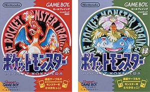

<!-- 底部人物档案卡片 -->

  

    

      
    

    

      <h3 class="fw-bold mb-2">石原 恒和（Tsunekazu Ishihara）</h3>
      
<strong>现任职务：</strong>株式会社宝可梦（The Pokémon Company）代表取締役社長 兼 首席执行官（CEO）

      

        1957年出生于三重县鸟羽市。1983年筑波大学大学院艺术研究科综合造型专业硕士毕业。作为独立游戏制作人参与多款名作研发，耗时三年撰写全球游戏考据巨著《電視遊戯大全》。1995年创立株式会社 Creatures。1996年担任《宝可梦 红·绿》统筹制作人（Producer），此后主导操盘全系列正统作品与衍生矩阵。主导构想发明了日本首款集换式卡牌游戏“宝可梦卡牌（PTCG）”。1998年创立宝可梦中心株式会社（现株式会社宝可梦）并出任代表取缔役社长至今，统领全球千亿级宝可梦帝国的游戏、影视、实体中心与跨界品牌运营。
      

    

  

